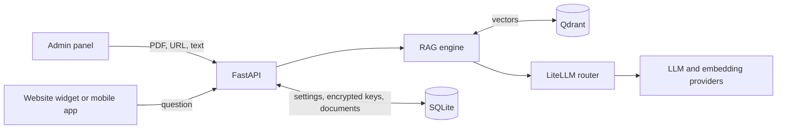

# OmniRAG Core


[](LICENSE)

Self-hosted Retrieval-Augmented Generation (RAG) appliance. Train it on PDFs, web pages and text, choose any LLM provider from a web panel, and add an AI chat widget to any website with one `<script>` tag.

## Features

- **Any LLM:** OpenAI, Groq, Google Gemini, Anthropic, Ollama, or any OpenAI-compatible endpoint (OpenRouter, DeepSeek, Together AI, vLLM, LM Studio). Switch live, without a restart.
- **Any embedding model:** OpenAI, Gemini, Ollama, or any OpenAI-compatible endpoint.
- **Grounded answers:** the model is instructed to answer only from your documents and returns its sources.
- **Web admin panel:** configure providers, test the connection, train and manage the knowledge base.
- **Embeddable widget:** plain JavaScript with no dependencies, for WordPress, Shopify, PHP or static HTML.
- **REST API:** for mobile apps and custom integrations.
- **Encrypted credentials:** API keys are encrypted with Fernet and masked in the panel.
- **Local embeddings included:** Ollama runs in the stack, with no API key needed.
- **Simple to run:** one Compose command, with embedded Qdrant and SQLite on a single volume.

## Contents

[How it works](#how-it-works) ·
[Quick start](#quick-start) ·
[Configuration](#configuration) ·
[Admin guide](#admin-guide) ·
[Ollama](#ollama) ·
[Embed the widget](#embed-the-widget) ·
[API](#api) ·
[Production notes](#production-notes) ·
[Development](#development-and-tests)

## How it works



Documents are split into chunks, embedded and stored in Qdrant. Each question is embedded, the four most similar chunks are retrieved, and the LLM answers from them.

## Quick start

Requires Docker with Compose v2.

```bash
git clone https://github.com/<your-username>/omnirag-core.git
cd omnirag-core
docker compose up -d --build
docker compose exec omnirag cat /app/data/.admin_password   # generated password
```

Open <http://localhost:8000/admin>. To choose your own credentials, create `.env` next to `docker-compose.yml` before the first start:

```bash
ADMIN_PASSWORD=a-long-random-password
MASTER_SECRET_KEY=output-of-openssl-rand-base64-48
```

When either value is unset, a random one is generated and kept in `data/` with owner-only permissions. Setting `MASTER_SECRET_KEY` yourself keeps the encryption key out of the data volume, so a copied volume does not expose API keys. If the key changes later, stored API keys cannot be decrypted until you restore it or enter them again.

## Configuration

| Variable | Default | Purpose |
|---|---|---|
| `ADMIN_PASSWORD` | generated | Required in the `x-admin-pass` header of admin requests |
| `MASTER_SECRET_KEY` | generated | Source of the Fernet key for API keys at rest |
| `OMNIRAG_PORT` | `8000` | Published host port |
| `MAX_UPLOAD_MB` | `25` | Largest accepted PDF |
| `CHAT_RATE_LIMIT_PER_MINUTE` | `30` | Public questions per client IP; `0` disables the limit |
| `ALLOW_PRIVATE_URLS` | `false` | Allow crawling URLs on private networks |
| `FORWARDED_ALLOW_IPS` | `127.0.0.1` | Reverse proxy addresses trusted for `X-Forwarded-*` headers |
| `OLLAMA_EMBED_MODEL` | `nomic-embed-text` | Model downloaded on startup |
| `OLLAMA_BASE_URL` | `http://ollama:11434` | Default Ollama address until one is saved in the panel |
| `OLLAMA_VERSION` | `0.40.16` | Ollama image tag |
| `LOG_LEVEL` | `INFO` | Server log level |

## Admin guide

1. **Models:** choose chat and embedding providers, enter credentials, then press **Test LLM Connection**. The test uses the values in the form before they are saved. Changes apply immediately. Model names are free-form; the suggestions are only shortcuts.
2. **Knowledge base:** upload a PDF, add a page URL, or paste text. Text is split into 800-character chunks with 120 characters of overlap. Scanned PDFs need OCR first. A URL adds that single page and does not run JavaScript.
3. **Widget and embed:** set the title and color, copy the snippet, and try a question.

Vectors from different embedding models cannot be mixed. After changing the embedding model, use **Reset knowledge base** and train again; until then, chat and training are refused instead of returning wrong results.

Groq and Anthropic can be used for chat but not for embeddings. Pair them with Ollama, Gemini, OpenAI or a custom embedding endpoint.

## Ollama

Ollama is part of the Docker stack, so embeddings work locally without an API key. `docker compose up -d` starts it and downloads `nomic-embed-text` in the background. The first start downloads several gigabytes; watch the model download with:

```bash
docker compose logs -f ollama-pull
```

In the admin panel, under **Models**:

1. Set the **embedding provider** to Ollama and the model to `nomic-embed-text`.
2. Keep the **Ollama base URL** as `http://ollama:11434`.
3. Choose any chat provider, such as Groq, and save.

To also chat with a local model, download one and select Ollama as the chat provider:

```bash
docker compose exec ollama ollama pull llama3.2
docker compose exec ollama ollama list
```

- **Storage:** models are kept in the `ollama_models` volume and survive restarts. `docker compose down -v` deletes them.
- **Memory:** embeddings need about 1 GB of free RAM. Chat models need several more; a small VPS is better served by a hosted chat provider.
- **GPU:** the bundled service runs on the CPU. Docker on macOS cannot use the Apple GPU; install Ollama natively if you need it.
- **Existing Ollama:** use `http://host.docker.internal:11434` as the base URL. On Linux it must listen on an address containers can reach (`OLLAMA_HOST=0.0.0.0`).
- **Without Ollama:** run `docker compose up -d --build omnirag`.

**Upgrading from a version without bundled Ollama:** run `docker compose up -d --build`. If you had saved another Ollama base URL, change it to `http://ollama:11434` in the admin panel.

"Network is unreachable", "connection refused" or "name or service not known" means Ollama is not running at the saved base URL. "Model not found" means the model has not been downloaded yet.

## Embed the widget

```html
<script src="https://rag.example.com/static/widget.js" defer></script>
```

Paste it before `</body>`. The widget finds its server from its own URL.

- **WordPress:** add it to your theme footer, or use a header/footer code plugin.
- **Shopify:** add it to `theme.liquid`.
- **PHP, Laravel, cPanel:** add it to the shared footer template.

Sites on HTTPS need OmniRAG on HTTPS as well. If the site sends a Content-Security-Policy, allow the OmniRAG origin in `script-src` and `connect-src`, and allow inline styles in `style-src`.

## API

Interactive documentation is at `/docs`.

| Method | Path | Body |
|---|---|---|
| GET | `/health` | |
| GET | `/api/public/widget-config` | |
| POST | `/api/public/chat` | `{"question": "..."}` |
| GET / POST | `/api/admin/settings` | any subset of the settings |
| POST | `/api/admin/test-llm` | optional unsaved settings |
| GET | `/api/admin/documents` | |
| DELETE | `/api/admin/documents/{id}` | |
| POST | `/api/admin/train/pdf` | multipart field `file` |
| POST | `/api/admin/train/url` | `{"url": "https://..."}` |
| POST | `/api/admin/train/text` | `{"title": "...", "text": "..."}` |
| DELETE | `/api/admin/reset` | |

```bash
curl -X POST http://localhost:8000/api/public/chat \
  -H 'Content-Type: application/json' \
  -d '{"question": "What is the refund policy?"}'
# {"answer":"...","sources":["Refund Policy"]}
```

Secrets are returned masked (`********ab12`). Sending a masked value back keeps the stored key; sending an empty string clears it. `test-llm` always returns HTTP 200 with `success` and either the reply or the provider's error message.

## Production notes

- Terminate HTTPS in a reverse proxy (Caddy, nginx, Traefik) and firewall port 8000. The admin password is sent with every admin request, so do not use plain HTTP across the internet.
- Behind a proxy, set `FORWARDED_ALLOW_IPS` to its address as seen by the container. Otherwise all visitors share one rate limit.
- The chat endpoint is public and can be called by anyone who finds it. Set a spending limit at your provider.
- Run one container per data directory. Embedded Qdrant locks its storage and scans every vector per query; it suits roughly 20,000 chunks or fewer.
- Back up by stopping the container and copying `data/` plus your `.env`.
- The URL crawler checks the resolved address of every redirect before connecting. This does not stop DNS rebinding, so only crawl sites you trust.

## Development and tests

Requires Python 3.11.

```bash
python3.11 -m venv .venv && source .venv/bin/activate
pip install -r requirements.txt
pytest
uvicorn app.main:app --reload
```

The suite has 135 tests. They mock LiteLLM and HTTP, so they need no network or keys. They also run in the image, after a build:

```bash
docker run --rm omnirag-core:1.0.0 python -m pytest -q -p no:cacheprovider
```

## Project structure

```text
omnirag-core/
├── app/
│   ├── main.py          # FastAPI app, admin and public endpoints
│   ├── database.py      # SQLite, Fernet encryption, document log
│   ├── llm_router.py    # Provider routing through LiteLLM
│   └── rag_engine.py    # Parsing, chunking, retrieval, grounded answers
├── static/
│   ├── admin.html       # Admin panel
│   └── widget.js        # Embeddable chat widget
├── tests/
│   └── test_omnirag.py
├── data/                # Persistent volume (not committed)
├── Dockerfile
├── LICENSE
├── docker-compose.yml
└── requirements.txt
```

## License

Released under the [MIT License](LICENSE).
